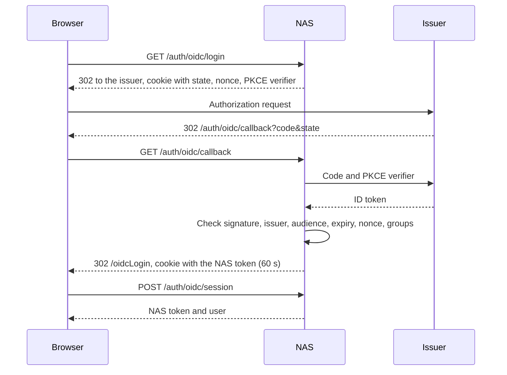

# Single Sign-On with OpenID Connect

`AUTH_TYPE=oidc` makes one OpenID Connect issuer the only way to sign in. The NAS shows no ID or password form and no Discord or Google button. A person who opens the NAS goes to the issuer, and comes back signed in.

The other modes (`local`, `oauth`, `both`) do not use any setting on this page. A deployment that keeps its mode needs no change.

## Requirements

- The NAS is served over HTTPS. The sign-in cookies are `Secure`, so a browser does not keep them on plain HTTP (a browser makes an exception for `localhost`).
- The issuer supports discovery (`/.well-known/openid-configuration`), the authorization code flow, and PKCE with `S256`.
- The ID token contains a claim that lists the group names of the user as a JSON array of strings.

## Settings

| Variable | Required | Default | Description |
|----------|----------|---------|-------------|
| `AUTH_TYPE` | Yes | `both` | Set to `oidc` |
| `OIDC_ISSUER` | Yes | | Issuer URL. It must be equal to the `issuer` value in the discovery document, character for character. Keep or remove the trailing `/` as the issuer does |
| `OIDC_CLIENT_ID` | Yes | | Client ID of the NAS at the issuer |
| `OIDC_CLIENT_SECRET` | Yes | | Client secret. `OIDC_CLIENT_SECRET_FILE` can name a file that contains it |
| `OIDC_REDIRECT_URI` | Yes | | `https://<your-nas>/auth/oidc/callback`. The NAS sends only this value as `redirect_uri` |
| `OIDC_IDP_HINT` | No | | Sent as the `idp_hint` parameter of the authorization request. Use it when the issuer supports this parameter, to skip the sign-in screen of the issuer and go to one upstream provider |
| `OIDC_SCOPES` | No | `openid profile email groups` | Scopes of the authorization request, separated by spaces. `openid` must be in the list |
| `OIDC_GROUPS_CLAIM` | No | `groups` | Name of the ID token claim that lists the groups |
| `OIDC_MEMBER_GROUP` | No | `nas_member` | Group whose members may sign in with the member permissions |
| `OIDC_ADMIN_GROUP` | No | `nas_admin` | Group whose members get the `ADMIN` intent |
| `OIDC_LOGOUT_URL` | No | | Address that the browser opens after sign-out. When it is empty, the NAS uses the `end_session_endpoint` of the issuer |

When `AUTH_TYPE=oidc` and a required value is missing, the server does not start. The error message names the missing variables, for example `AUTH_TYPE=oidc requires OIDC_CLIENT_SECRET, OIDC_REDIRECT_URI`. The message never contains a value.

Write `AUTH_TYPE=oidc` in lower case, with nothing before or after the value. `docker run --env-file` keeps quotes, trailing spaces, and a `# comment` as part of the value. The server also does not start in these two cases:

- `AUTH_TYPE` becomes `oidc` only after spaces, quotes, and a comment are removed and the letters are changed to lower case, for example `OIDC` or `oidc   # comment`.
- `AUTH_TYPE` is not `local`, `oauth`, `both`, or `oidc`, and one of `OIDC_ISSUER`, `OIDC_CLIENT_ID`, `OIDC_CLIENT_SECRET`, `OIDC_REDIRECT_URI` is set.

Any other unknown `AUTH_TYPE` value starts the server as in v0.6.0, and the log shows the warning `AUTH_TYPE is not one of local, oauth, both, oidc`.

With Docker Compose, put these variables in `.env`. The `env_file` entry of `docker-compose.yml` passes them to the container.

```env
AUTH_TYPE=oidc
OIDC_ISSUER=https://login.example.com/auth/v1
OIDC_CLIENT_ID=nas
OIDC_CLIENT_SECRET=replace-with-the-client-secret
OIDC_REDIRECT_URI=https://nas.example.com/auth/oidc/callback
```

## Client at the Issuer

Create a confidential client with these values.

| Item | Value |
|------|-------|
| Flow | Authorization code, PKCE `S256` |
| Redirect URI | `https://<your-nas>/auth/oidc/callback` |
| Back-channel logout URI | `https://<your-nas>/auth/oidc/backchannel` |
| Scopes | The scopes in `OIDC_SCOPES` |
| ID token | Contains the groups claim |

The NAS reads the signing algorithms from the discovery document. ID tokens signed with `RS256` and with `EdDSA` are covered by the automated tests.

## Sign-In



- The state cookie is `Secure`, `HttpOnly`, `SameSite=Lax`, has the `__Host-` prefix, and expires after 10 minutes.
- The NAS token is never part of an address. The front end reads it one time with `POST /auth/oidc/session`.
- A failed sign-in ends on `/oidcLogin?error=<code>`. The codes are `denied` (no NAS group), `failed` (the response could not be verified), `unavailable` (the issuer did not answer), and `conflict` (see below).

## Users, Groups, and Permissions

The NAS identifies a person by the `sub` claim. It stores the value as the `oidc` identity of the user (`user_identities.provider = 'oidc'`).

| Groups in the ID token | Result |
|------------------------|--------|
| Member group | Sign-in. A new user gets `VIEW`, `OPEN`, `DOWNLOAD`, `UPLOAD`, `COPY`, `RENAME` |
| Admin group | Sign-in. A new user gets `ADMIN` |
| Both groups | Sign-in. A new user gets all of the above |
| None of the two | Sign-in is refused. No user is created |

- The groups decide the permissions only when the NAS creates the user. After that, an administrator changes permissions in the user manager, and a later sign-in does not change them.
- A user who is no longer in one of the two groups cannot sign in again.
- A new user gets `userId = sub`. The name comes from `preferred_username`, then `email`, then `name`.
- `conflict` means that a user with the same `userId` exists without the `oidc` identity. Link the two with the `oidc-link` command below.

## Sign-Out and Back-Channel Logout

Sign-out in the NAS removes the NAS token from the browser and opens `/auth/oidc/logout`. That address redirects to `OIDC_LOGOUT_URL`, or to the `end_session_endpoint` of the issuer with the `client_id` parameter. If the issuer has no `end_session_endpoint`, the browser stays on a signed-out page of the NAS.

The issuer can end the NAS sessions of a user with `POST /auth/oidc/backchannel` ([OpenID Connect Back-Channel Logout 1.0](https://openid.net/specs/openid-connect-backchannel-1_0.html)). The NAS accepts a `logout_token` only when all of these are true:

- The signature matches a key of the issuer, and `iss` and `aud` match the settings.
- The `events` claim contains `http://schemas.openid.net/event/backchannel-logout`, and there is no `nonce` claim.
- `exp` is in the future, `iat` is not older than 5 minutes, and `jti` was not used before.
- The token has a `sub` claim. A token with only `sid` is refused, because the NAS does not record issuer sessions.

The NAS then writes the current time to `users.tokens_valid_after` (Unix time in milliseconds). From that moment the NAS rejects each token of this user that was issued earlier, with `401`. A token from before v0.7.0 has no `issued_at` claim. Such a token stays valid while `tokens_valid_after` is empty, and is rejected after the first back-channel logout of its user.

In `oidc` mode the NAS also rejects the token of a user who was deleted from the NAS.

## Closed Routes

In `oidc` mode these routes answer `403` with the message `This sign-in method is disabled. Sign in through single sign-on.`

- `POST /auth/register`, `POST /auth/login`, `POST /auth/change-password`
- `GET /auth/discord/callback`, `GET /auth/google/callback`
- `POST /auth/discord/register`, `POST /auth/google/register`
- `POST /auth/link/start`, `POST /auth/link/discord/complete`, `POST /auth/link/google/complete`
- `DELETE /auth/identities/{provider}`

`GET /auth/config` reports only OIDC. `POST /requestAdminIntent` (the admin password) and `/admin/oauth-config` stay as they are.

## Switching an Existing Deployment to OIDC

Existing users keep their account, permissions, and files when the NAS knows which `sub` belongs to which user. The `oidc-link` command writes this link. Do the steps in this order.

1. Back up the database file (`nas.sqlite`).
2. Upgrade to v0.7.0 and keep the current `AUTH_TYPE`. Make sure that sign-in works as before.
3. Create the client at the issuer (see above).
4. Write a CSV file with one line for each person: the ID at the old sign-in provider, then the `sub` at the new issuer.

   ```csv
   # old Google ID, new sub
   108234567890123456789,2f9c1e5a7b3d4c6e8a0b
   104987654321098765432,7d1a3c5e9f2b4d6a8c0e
   ```

   For `--from google` the old ID is the Google subject. For `--from discord` it is the Discord user ID. For `--from local` it is the local user ID. Some issuers that sign users in through Google keep the Google subject of each user, for example as a federation ID in their user API. That value is the old ID.
5. Run the command with `--dry-run`. It prints one line for each CSV line and writes nothing.

   ```bash
   docker cp oidc-map.csv nas-app:/tmp/oidc-map.csv
   docker exec nas-app /app/server oidc-link --map /tmp/oidc-map.csv --from google --dry-run
   ```

   | Output | Meaning |
   |--------|---------|
   | `linked (name)` | The identity is added (in a dry run: it would be added) |
   | `already linked (name)` | Nothing to do |
   | `no NAS user` | No NAS user has this old ID. This is normal for people who never used the NAS |
   | `conflict (name): ...` | The `sub` belongs to another NAS user, or the user has another `sub`. Correct the CSV line |

   The output shows NAS user names and CSV line numbers. It does not show the IDs, the `sub` values, or any secret.
6. Run the command again without `--dry-run`. The command can run more than one time with the same file. The exit code is `1` when a line has a conflict.
7. Set `AUTH_TYPE=oidc` and the `OIDC_*` variables, then restart the NAS.
8. Sign in as an existing user and make sure that the user ID and the permissions are the same as before.

Tokens from the old sign-in stay valid until they expire (7 days) or until a back-channel logout for their user arrives. To end all old sessions at the moment of the switch, change `PRIVATE_KEY` in the same restart. Public download links do not depend on `PRIVATE_KEY`.

### Going Back

Set `AUTH_TYPE` to the old value and restart. The `oidc` identities and the `tokens_valid_after` column can stay. v0.6.0 also starts with this database and ignores both. A user who was created in `oidc` mode has only the `oidc` identity and cannot sign in in another mode.

## Limits

- The list of used `logout_token` IDs is kept in memory. After a restart, a `logout_token` that is younger than 5 minutes is accepted one more time. The result is one more sign-out of the same user.
- Each `logout_token` with an unknown signing key makes the NAS read the keys of the issuer again. If the back-channel address is public, limit its request rate at the reverse proxy.
- Public download links of a user stay valid after a back-channel logout. They stop when the user loses the `DOWNLOAD` intent or is deleted.
- The NAS reads the discovery document at the first sign-in and keeps it until the next restart. Key changes of the issuer need no restart.
